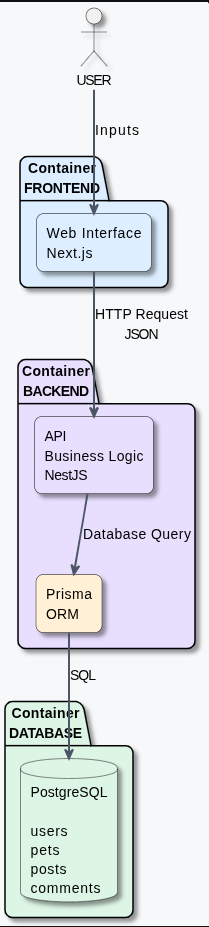
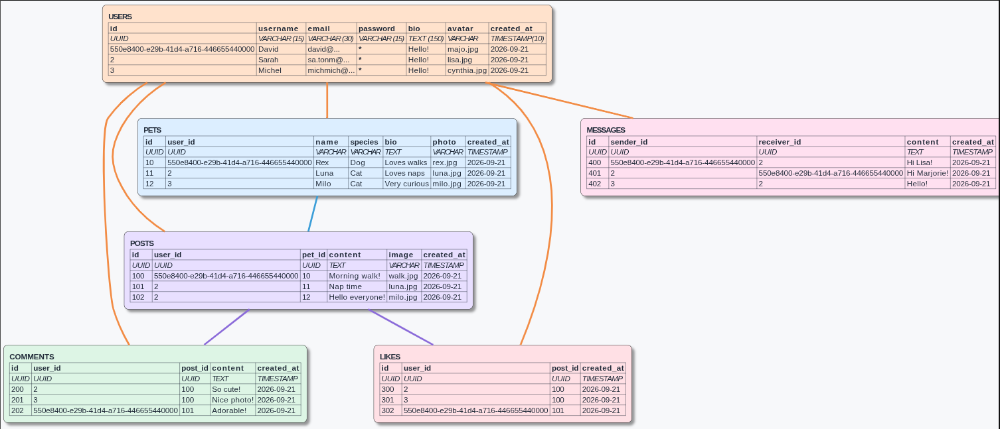

## Descrpition
PostgreSQL is a **Relational Database Management System (RDBMS)**. Its role is to store, organize, secure, and retrieve data. It is free and open-source. It can store a vast array of different **data types**. Its primary language is **SQL**, though it supports other languages ​​as well. It is a system that executes transactions adhering to **ACID** properties. **MVCC** is used to ensure complete isolation during transactions.



*This is a representative image, not an exact depiction of our project.*

### RDBMS
Relational Database Management System (RDBMS) means it's a database that organizes information into **tables** linked by relationships. Each table represents an entity (users, pets, etc.), and the first data item is an ID that uniquely identifies each row in the table. Using this ID—or key—it is possible, for example, to associate a user with a pet or with multiple pets. In this projet we use ID in **UUID**.

### Data Types
PostgreSQL offers a wide range of natively available data types. It is important to choose the right data type to ensure data integrity, optimize performance, and reduce storage space.

### SQL
Structured Quesry Language is the programming language used to interact with databases. It is used to create tables, insert data, retrieve it, query it, and so on. There are four main operations grouped under the term CRUD :
	- **CREATE** : add data
	- **READ** : read data
	- **UPDATE** : modify data
	- **DELETE** : delete data

### ACID
ACID is a set of four properties that ensure a database transaction remains reliable and consistent, even in the event of an error, simultaneous access by multiple users, or an interruption :
  - Atomicity : a transaction is completed in its entirety or not at all.
  - Consistency : in the event of an error during a transaction, the state reverts to what it was prior to the transaction.
  - Isolation : a transaction does not interfere with the others.
  - Durability : the data remains available in the event of a restart.

### MVCC
**M**ulti-**V**ersion **C**oncurrency **C**ontrol is a computing method used in database management systems to allow multiple users to read and write data simultaneously without blocking each other.

### Tables
A table is a structure used to store a set of data regarding a single entity. It consists of columns and rows of data. Each column has a predefined data type. While some data values ​​may be identical, each row is unique thanks to its primary key (ID). Each column holds only a single piece of information.


*This is a representative image, not an exact depiction of our database.*

### UUID
**U**niversally **U**nique **ID**entifier it's an identifier designed to be unique; it's a large value displayed as 32 hexadecimal characters separated by hyphens. It is automatically generated by Prisma when a new data record is created. Example : 550e8400-e29b-41d4-a716-446655440000

### Prisma
Prisma is an **ORM** (Object-Relational Mapping) tool that provides an interface between the backend application and the PostgreSQL database. It allows the database structure and relationships to be defined in a `schema.prisma` file, manages database changes through migrations, and provides Prisma Client to interact with the data from the backend without having to write SQL queries manually.

Prisma consists of three main components:

  - **Prisma Schema**: Defines the database structure, including models, fields, data types, and relationships between tables.

  - **Prisma Migrate**: Manages database structure changes by generating and applying SQL migrations based on the Prisma Schema.

  - **Prisma Client**: Allows the backend to interact with PostgreSQL and perform CRUD operations (Create, Read, Update, Delete).

  How it's works:

```text
          schema.prisma
                |
                |
        +-------+-------+
        |               |
        v               v
  Prisma Migrate   Prisma Generate
        |               |
        v               v
   PostgreSQL      Prisma Client
   (structure)          |
                        |
                        v
                   Backend NestJS
                        |
                        v
                    PostgreSQL
                     (data)
```

**Prisma Commands**:

Prisma provides several commands to manage and interact with the database schema:

- `npx prisma generate` — Generates or regenerates Prisma Client from the current Prisma schema. It should be run after changes that affect the generated client.

- `npx prisma format` — Automatically formats the `schema.prisma` file and checks its syntax.

- `npx prisma validate` — Checks that the `schema.prisma` file is valid and reports syntax or configuration errors without modifying the database.

- `npx prisma migrate dev --name <migration_name>` — Creates a new migration from the changes made in `schema.prisma` and applies it to the development database. The generated migration files are stored in the `prisma/migrations` directory.

- `npx prisma migrate status` — Displays the current migration status and indicates whether the database schema is up to date with the existing migrations.

- `npx prisma migrate reset` — Resets the development database, reapplies all migrations from the beginning and deletes all existing data. This command should therefore be used with caution.

- `npx prisma studio` — Opens Prisma Studio, a graphical interface in the browser that can be used to view and manage the data stored in the database.

## Ressources

- Official docs (EN, FR):
	* https://www.postgresql.org/docs/current/
  * https://docs.postgresql.fr/

- Youtube tuto for PostgreSQL (FR):
  * https://www.youtube.com/playlist?list=PLy8DguObsSuZOpEaANfgf_cccmnWiPW39

- Various resources for understanding RDBMS:
	* https://fr.wikipedia.org/wiki/Propri%C3%A9t%C3%A9s_ACID
	* https://fr.wikipedia.org/wiki/Multiversion_Concurrency_Control
  * https://www.databricks.com/fr/blog/sql-data-types

- Prisma:
  * https://www.prisma.io/docs/orm/v7
